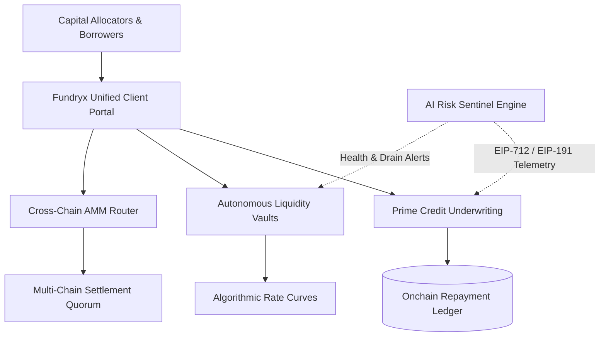
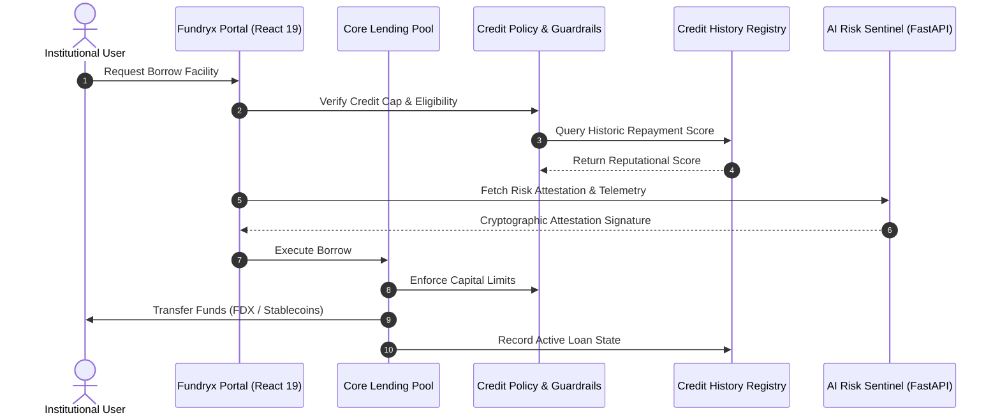

<div align="center">


### Institutional Autonomous Capital & Liquidity Orchestration Network

[](https://soliditylang.org/)
[](https://getfoundry.sh/)
[](https://react.dev/)
[](https://tailwindcss.com/)
[](https://fastapi.tiangolo.com/)
[](LICENSE)

[Live Portal](#-system-architecture) • [Core Capabilities](#-core-capabilities) • [Cross-Chain Matrix](#-cross-chain-liquidity-engine) • [Security & Invariants](#-security-boundaries--invariants) • [Quick Start](#-quick-start)

---

</div>

<p align="center">
  
</p>

## 🌐 Overview

**FUNDRYX** is an institutional-grade onchain capital orchestration protocol. Designed for high-velocity Web3 treasury operations, institutional uncollateralized lending facilities, cryptographic credit underwriting, and non-custodial cross-chain liquidity dispatching.

The network combines smart contract-enforced capital routing with offchain **AI Risk Sentinel Telemetry** and automated multi-chain bridge discovery to deliver frictionless institutional capital deployment across EVM ecosystems.

---

## ⚡ Core Capabilities



### 1. Prime Uncollateralized Credit Facilities
- **Zero-Haircut Capital Routing**: Cryptographic reputational lending without capital-inefficient overcollateralization.
- **Dynamic Risk-Priced Curves**: Algorithmic interest rate curves updating borrow APR and supply yields per second based on active pool utilization.
- **Tenure Protection & Structured Terms**: Pre-programmed 7, 14, 30, and 60-day debt tenure tranches with deterministic repayment pacing.

### 2. Reputational Identity & Credit Scoring
- **Tier 1 Prime Underwriting**: Mathematical scoring scale (0 to 850) calculated from verified onchain debt settlement records.
- **Credit Tier Classification**:
  - `Tier 1 Prime (750 - 850)`: Maximum capacity and preferential borrow spreads.
  - `Tier 2 Growth (650 - 749)`: Standard institutional facilities with graduated caps.
  - `Tier 3 Emerging (< 650)`: Micro-facilities under tight velocity boundaries.
- **Immutable Provenance**: Immutable onchain repayment receipts proving institutional solvency and credit history.

### 3. AI Risk Sentinel Quorum
- **Autonomous Telemetry Sensors**: Continuous offchain monitoring of wallet borrow velocity, pool drain anomalies, and market volatility.
- **Multi-Validator Consensus**: Multi-signature oracle consensus before credit ceiling expansions or risk tier elevations.
- **Advisory Trust Boundary**: The AI layer operates within strict advisory constraints—preventing false positives from stalling non-custodial debt repayment.

### 4. Cross-Chain Liquidity Engine & AMM
- **12-Route Directed Bridge Matrix**: Automated cross-chain liquidity dispatching across Polygon, Monad, Avalanche, and Base.
- **Zero-Trust Destination Settlement**: Self-serve recipient claim flow guaranteeing capital delivery even in the absence of centralized offchain relayers.
- **Constant-Product AMM**: Onchain liquidity pools with strict slip tolerance protection and automated fee compounding.

---

## 🏛 System Architecture

The Fundryx system architecture decouples user experience, capital management, and oracle telemetry into isolated, self-healing layers:



---

## 🔀 Cross-Chain Liquidity Engine

Fundryx facilitates frictionless multi-chain asset routing through automated pathfinding and verifiable destination settlement:

| Network Family | Supported Assets | Bridge Mechanism | Settlement Model |
|:---|:---|:---|:---|
| **Polygon Network** | `FDX`, `fUSD`, `USDC`, `WPOL`, `POL` | Chainlink CCIP / Router Protocol | Atomic Relayer / Self-Claim Fallback |
| **Monad Network** | `FDX`, `fUSD`, `WMON`, `MON` | Cross-Chain Router | Cryptographic Sentinel Settlement |
| **Avalanche Network** | `FDX`, `fUSD`, `USDC`, `WAVAX`, `AVAX` | Chainlink CCIP / Router Protocol | Recipient Settlement Execution |
| **Base Network** | `USDC`, `ETH`, `WETH` | LI.FI Multi-Bridge Aggregator | Enterprise Hybrid Gateway |

### Strict Environment Partitioning
- **Testnet / Mainnet Segregation**: Cross-environment transfers (e.g. Testnet to Mainnet) are strictly prevented by route invariant checks.
- **Truthful Status Polling**: Bridge transfers query real-time onchain receipts and relayer states without synthesizing synthetic execution hashes.

---

## 📦 Smart Contract Architecture

The protocol contracts are built with **Solidity 0.8.24** using OpenZeppelin v5 standards and compiled via **Foundry**:

```
contracts/
├── core/
│   ├── AccessManager.sol             # Hierarchical role-based access control
│   ├── PauseController.sol           # Emergency circuit-breaker mechanisms
│   ├── FundryxToken.sol              # Institutional protocol settlement token (FDX)
│   └── FundrexCrossChainRouter.sol    # Cross-chain liquidity routing and bridge settlement
├── lending/
│   ├── LendingPool.sol               # Core capital routing, vaults, borrow/repay execution
│   ├── CreditPolicy.sol              # Underwriting policy, LTV parameters, borrowing caps
│   └── CreditHistoryRegistry.sol     # Immutable onchain borrower credit & repayment ledger
├── monitoring/
│   └── RiskAttestationRegistry.sol   # EIP-191 / EIP-712 Sentinel Quorum verification registry
└── interfaces/                       # Type-safe protocol ABI contracts
```

---

## 🔒 Security Boundaries & Invariants

1. **Reentrancy Immunity**: All state-mutating deposit, borrow, swap, and repay functions inherit OpenZeppelin `ReentrancyGuard`.
2. **Access Role Partitioning**: Protocol operations are segregated into distinct cryptographic roles:
   - `ADMIN_ROLE`: High-level configuration and policy parameter upgrades.
   - `OPERATOR_ROLE`: System parameter synchronization and liquidity rebalancing.
   - `MONITOR_SIGNER_ROLE`: Risk attestation signatures from validated sentinel daemons.
   - `LENDING_POOL_ROLE`: Direct execution authorization for lending vaults.
3. **Emergency Circuit Breakers**: `PauseController` allows immediate multi-signature pausing of new borrows during extreme market volatility while preserving repayment and lender withdrawal rights.
4. **Non-Custodial Invariants**: Funds deposited in liquidity pools cannot be seized or frozen arbitrarily by administrative keys.

---

## 🚀 Quick Start

### Prerequisites
- [Foundry](https://getfoundry.sh/) (`forge`, `cast`)
- [Node.js](https://nodejs.org/) (v18 or higher)
- [Python](https://www.python.org/) (v3.10 or higher)

### 1. Repository Setup

```bash
# Clone the repository
git clone https://github.com/bhasitgupta/FUNDRYX.git
cd FUNDRYX

# Copy environment template
cp .env.example .env
```

### 2. Smart Contract Testing & Compilation

```bash
# Compile contracts with Foundry
forge build

# Execute smart contract test suite with gas reporting
forge test -vvv
```

### 3. Backend Risk Sentinel Telemetry

```bash
# Navigate to backend and install requirements
cd backend
pip install -r requirements.txt

# Execute test suite
python -m unittest test_backend.py

# Launch FastAPI telemetry service
uvicorn main:app --host 127.0.0.1 --port 8000 --reload
```

### 4. Institutional Web Portal

```bash
# Navigate to frontend
cd frontend

# Install dependencies
npm install

# Run automated cross-chain and unit test suite
npm test

# Launch local development server
npm run dev

# Build production bundle
npm run build
```

---

## 🛠 Technology Stack

- **Smart Contracts**: Solidity `0.8.24`, Foundry, OpenZeppelin Contracts v5.
- **Frontend**: React 19, Vite, Tailwind CSS v4, Ethers.js v6, Lucide Icons, Hugeicons.
- **Backend & Oracles**: Python 3.11+, FastAPI, Web3.py, Pydantic, EIP-191 Cryptographic Signers.
- **Storage & Relational Indexing**: Supabase, PostgreSQL.
- **Interoperability**: LI.FI API, Chainlink CCIP, Native Multi-Chain Routers.

---

## 📄 License

This repository is distributed under the **MIT License**. See [`LICENSE`](LICENSE) for detailed terms.
