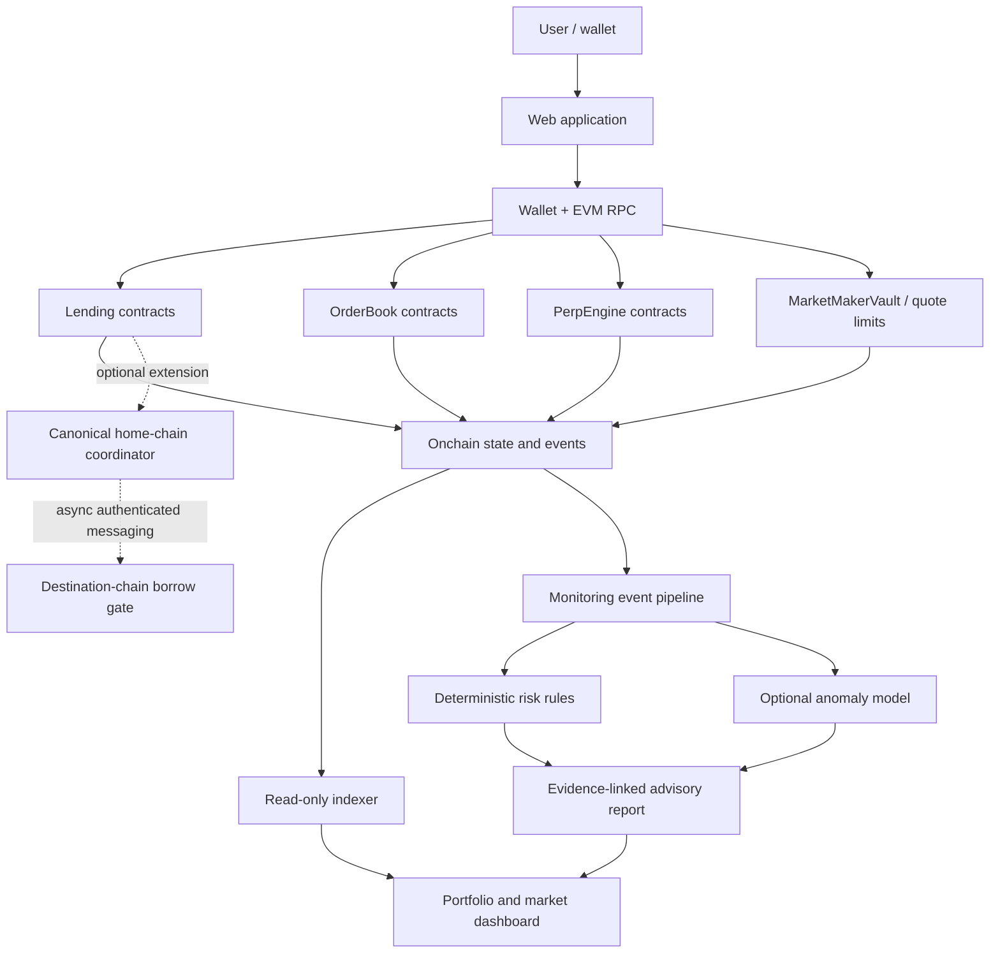
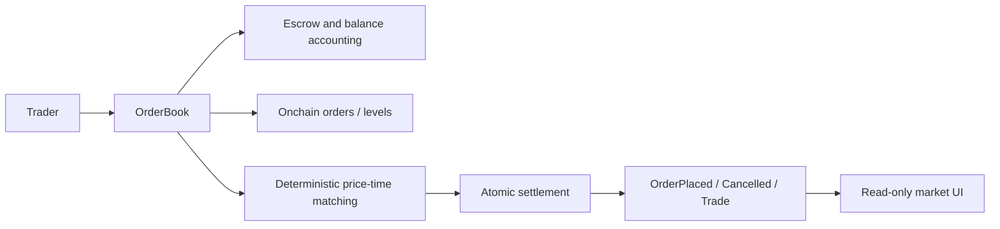
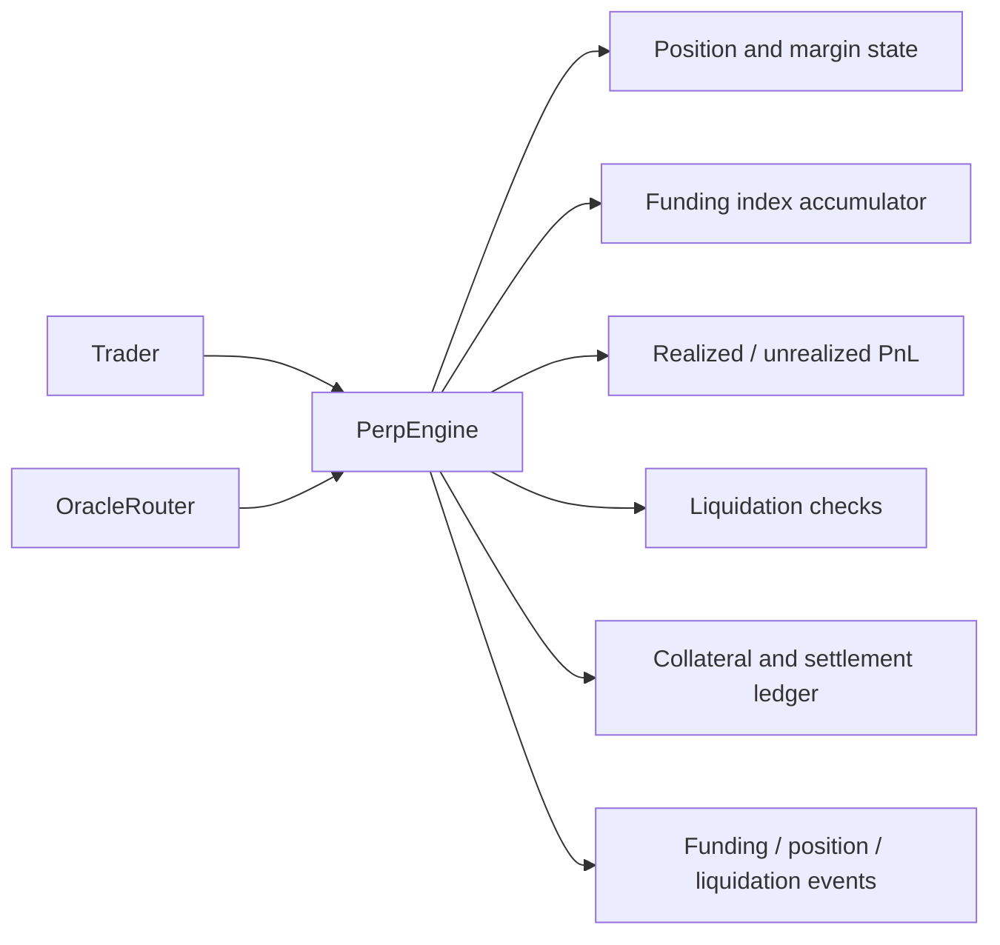
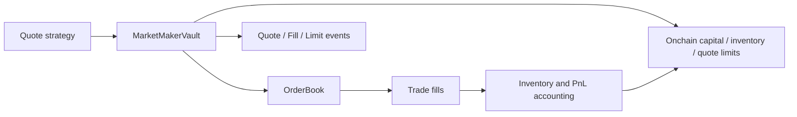
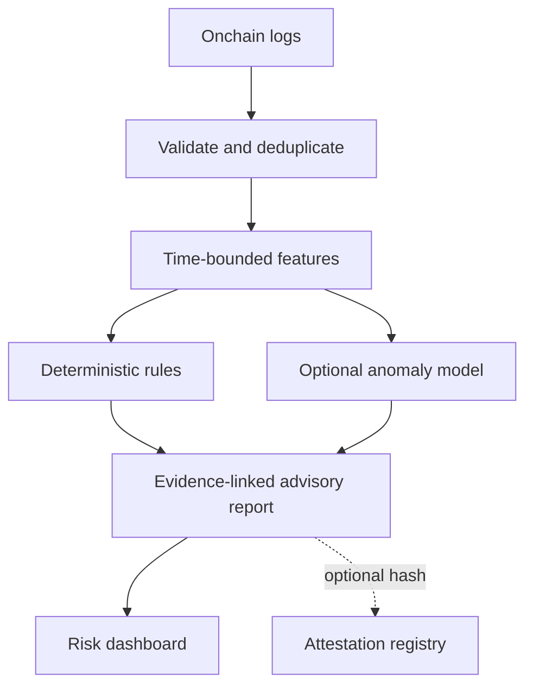

# AUREX V4 — Master Architecture and Challenge Traceability

**Release:** V4.0.0  
**Purpose:** Translate the organizer's exact challenge into a buildable system, with all four markets implemented in four sequential milestones.  
**Status:** Architecture specification only. This document does not claim implementation, audit, or deployment.

## 1. Challenge statement and interpretation

The challenge requires a functional prototype demonstrating how blockchain-native infrastructure can create transparent trading or lending markets without relying on centralized offchain infrastructure for core execution.

AUREX's success is measured by observable protocol behavior:
- financial state is held in smart contracts;
- key rules are enforced by contracts, not trusted to a backend;
- transactions settle onchain and are independently inspectable;
- failure conditions reject invalid state transitions;
- the demo clearly distinguishes live contracts from mocks and future work.

The listed directions are possible market mechanisms. This project has committed to implementing all four in order, but they are not all built at once.

## 2. Problem-to-solution traceability

| Challenge element | AUREX response | Required onchain authority | Acceptance evidence |
|---|---|---|---|
| Fully onchain financial product | Contract-enforced markets | Authoritative balances, orders/positions/loans, policy bounds, settlement | Contract state and explorer-verifiable transactions |
| Fast blockchain settlement | Transactions settle on selected EVM chain | Financial state changes and events | Real testnet transaction; report measured latency only if measured |
| Transparent trading/lending | Public state, versioned terms, explicit events | Financial parameters and state transitions | UI reads contract state and exposes transaction links |
| Onchain order book | Order escrow, deterministic price-time matching | Order lifecycle, matching, atomic settlement | Match/cancel/partial-fill tests and event trace |
| Perpetual futures | Position and margin engine with funding index | Margin checks, funding accounting, PnL and liquidation | Position lifecycle and adversarial liquidation tests |
| Onchain credit-history lending | Verified history + deterministic bounded credit policy | Accepted history, credit caps, loan state, debt accounting | Forged-history rejection, over-limit rejection, repayment lifecycle |
| Onchain market making | Onchain enforcement of quote, capital and inventory limits | Order/quote validation, vault inventory, settlement | Limit-breach rejection and fill accounting |
| Supporting cross-chain model | Reservation-first coordinator + adapter | Global reservation ledger if live route is enabled | Mock tests first; route-specific integration tests before any live claim |
| Supporting AI model | Rules and optional anomaly detection | Optional report hash/attestation only | Evidence-linked advisory report; no authority over financial state |

## 3. System context



The UI and indexer are not financial sources of truth. Monitoring may be offchain; contract checks remain authoritative. Cross-chain is an extension, not a dependency for the first market to prove the core challenge.

## 4. Shared architecture and market boundaries

### Shared services

| Component | Responsibility | Explicit boundary |
|---|---|---|
| `AccessControl` / role policy | Configure trusted roles and admin separation | Admins cannot bypass financial invariants |
| `PauseController` or equivalent | Stop risk-increasing actions during incidents | Define which safe exits remain available |
| Token/accounting interfaces | Normalize token transfers and decimals | Never assume all ERC-20s behave identically; MVP uses a known test token |
| Event model | Expose state changes for explorer/indexer | Events supplement contract state; they do not replace it |
| Read-only indexer | Search, aggregate, and render market data | Rebuildable from chain; no privileged financial writes |
| Oracle adapter | Normalize price feed inputs for perps or price-dependent products | Required only where prices are used; stale/invalid data blocks risk-increasing actions |
| Cross-chain adapter | Transport authenticated messages when extension is activated | Transport is not credit authority |
| Advisory monitor | Detect anomalies and attach evidence | Cannot make or execute financial decisions |

### Market contracts

| Module | Authoritative state | Key invariant |
|---|---|---|
| `CreditHistoryRegistry` | Accepted verified loan/repayment records | User cannot self-attest successful repayment |
| `CreditPolicy` | Policy version, formula, caps | Requested credit never exceeds policy or protocol limits |
| `LendingPool` | Deposits/liquidity, loans, debt, repayment, exposure | No loan without fresh policy check, liquidity, and unique loan ID |
| `OrderBook` | Orders, escrow, fills, cancellations | Fills obey deterministic priority and both sides settle atomically |
| `PerpEngine` | Positions, margin, funding index, PnL, liquidation state | Risk-increasing actions respect margin and valid prices |
| `MarketMakerVault` | Inventory, capital, quote bounds, fills | Quotes and fills cannot exceed configured risk limits |

These are logical boundaries. A small prototype may combine implementation files if needed, but state ownership, roles, and invariants must remain distinct.

## 5. Milestone 1 — credit-history-aware lending

```mermaid
flowchart LR
    WALLET[Borrower wallet] --> UI[Borrow UI]
    UI --> PREVIEW[CreditPolicy preview]
    PREVIEW --> UI
    UI -->|borrow(amount, policyVersion)| POOL[LendingPool]
    POOL --> HISTORY[CreditHistoryRegistry]
    POOL --> POLICY[CreditPolicy checks]
    POOL --> LIQ[Available liquidity / exposure]
    POOL --> TOKEN[Test ERC-20 transfer]
    POOL --> LOAN[Loan and debt state]
    LOAN --> EVENTS[LoanCreated / LoanRepaid events]
    EVENTS --> EXP[Explorer + dashboard]
```

### Borrow bound

The contract recomputes eligibility at execution; the frontend preview is indicative only.

`borrowAmount <= min(policyCreditLimit, availablePoolLiquidity, localExposureHeadroom, perLoanCap)`

The prototype must define and version the formula, inputs, weights, caps, rounding, and boundary behavior before implementation. No borrower-supplied claim is accepted as verified history. If this first market is genuinely undercollateralized and does not use prices, do not introduce an unnecessary oracle dependency.

### Borrow/repay sequence

```mermaid
sequenceDiagram
    actor B as Borrower
    participant UI as Web UI
    participant P as CreditPolicy
    participant L as LendingPool
    participant H as CreditHistoryRegistry
    participant T as ERC20
    B->>UI: Connect wallet and inspect terms
    UI->>P: previewEligibility(borrower)
    P-->>UI: Indicative terms + policy version
    B->>L: borrow(amount, policyVersion)
    L->>H: Read accepted repayment history
    L->>P: Recompute eligibility and caps
    L->>L: Check liquidity, exposure, pause, loan constraints
    alt All checks pass
        L->>T: Transfer amount to borrower
        L->>L: Record debt, loan ID, due date and exposure
        L-->>UI: LoanCreated event and transaction hash
    else Any check fails
        L-->>UI: Revert; no loan is created
    end
    B->>L: repay(loanId, amount)
    L->>T: TransferFrom borrower
    L->>L: Update debt and exposure
    L->>H: Update history only from verified contract state
    L-->>UI: LoanRepaid / LoanUpdated event
```

**Accounting rule:** partial repayment reduces debt but does not count as a completed loan. Completed status is recorded only after full principal and applicable fees are settled according to the implemented loan terms. Overdue/default transitions and authorized triggers must be defined and tested.

## 6. Milestone 2 — fully onchain order book



Requirements:
- A funded order cannot be placed unless sufficient assets are escrowed or locked.
- Matching priority is deterministic and documented (price first, then time/sequence).
- Partial fills update remaining quantity correctly; cancellation affects only unfilled quantity.
- Trade settlement updates both parties atomically or the whole transaction reverts.
- No private backend matcher is authoritative if the product is described as fully onchain.
- Benchmark bounded order counts and gas. Do not claim exchange-scale throughput from a small prototype.

## 7. Milestone 3 — perpetual futures



Requirements:
- Define margin ratio, leverage cap, position sizing, fees, funding formula, rate bounds, mark/index price relationship, liquidation incentive, and bad-debt handling.
- Each position stores its last observed cumulative funding index; funding due is calculated from the index delta when touched.
- “Funding updated every block” does not mean code executes automatically every block. Specify who invokes updates and how the cumulative index accrues.
- Stale, invalid, or manipulated oracle inputs must not enable risk-increasing actions.
- Do not begin this milestone until its oracle and liquidation design is testable.

## 8. Milestone 4 — onchain market making



Requirements:
- Enforce maximum inventory, notional exposure, allocated capital, minimum spread, quote freshness/nonce, and authorized operator.
- If an offchain strategy calculates quotes, label the strategy hybrid; execution and risk limits remain onchain.
- AI may suggest quote changes but cannot bypass contract limits.
- The market maker is not complete until fills, cancellations, inventory changes, and limit breaches are tested.

## 9. Supporting cross-chain model (not an MVP blocker)

Cross-chain coordination is valuable if credit capacity must be shared across chains. It is not necessary to prove the first single-chain market. Build the interface and mock state machine early, then enable a live provider only after route verification.

```mermaid
sequenceDiagram
    actor B as Borrower
    participant D as DestinationGate
    participant A as Adapter
    participant M as MessageTransport
    participant H as HomeCoordinator
    B->>D: Request destination loan
    D->>A: Request reservation with unique request ID
    A->>M: Authenticated request
    M->>H: Deliver request
    H->>H: Check global capacity and reserve atomically
    H-->>M: Reservation result + ID
    M-->>A: Deliver response
    A->>D: Relay authenticated response
    D->>D: Verify source, amount, borrower, chain, expiry, unused ID
    alt Confirmed valid reservation
        D->>D: Consume reservation once and disburse
    else Pending / invalid / replayed / expired
        D-->>B: Fail closed; no disbursement
    end
```

If live cross-chain is activated:
1. `globalOutstandingExposure + activeReservations <= globalCreditCapacity`.
2. Reservation IDs are consumed at most once.
3. Messages authenticate adapter, source chain, and source contract.
4. Borrower, amount, destination chain, policy version, nonce, and expiry are bound to the reservation.
5. Duplicate delivery is idempotent.
6. Timeout alone does not prove the destination did not consume a reservation. Use a safe cancellation handshake or retain the reservation until consumption is resolved.
7. Cross-chain execution is asynchronous; do not claim atomicity.
8. Provider selection is gated on official route support and verified deployment configuration. No addresses are invented.

## 10. Supporting AI risk monitoring (advisory only)



- Start with deterministic rules; examples include repeated failed borrow attempts, concentration thresholds, overdue states, repeated message IDs, and unusual transaction bursts.
- An ML model such as Isolation Forest is optional and should be used only if the team has a defensible feature set and evaluation. Synthetic data must be labelled synthetic. Do not fabricate accuracy metrics.
- An LLM may summarize structured evidence, but it must not originate authoritative facts or determine credit eligibility.
- Monitoring outages must not change market rules.
- AI cannot transfer funds, alter policy, reserve/release credit, or liquidate positions.
- Raw personal data and feature vectors should not be stored onchain. A registry, if used, stores compact report hashes and provenance metadata.

## 11. Shared IDs and data boundaries

- `user`: wallet address scoped by chain; do not assume one address equals one human.
- `loanId`: unique within a deployment; external records include chain ID and contract address.
- `orderId`, `tradeId`, `positionId`: unique per market deployment with chain and contract context.
- `reservationId`: coordinator-issued unique identifier; used only when cross-chain is active.
- `messageId`: transport ID plus application idempotency key.
- `reportId`: unique monitoring report with source block range and evidence references.
- `policyVersion`, `fundingConfigVersion`, `riskConfigVersion`, `ruleVersion`, `modelVersion`: explicit versioned configuration.

Do not store unnecessary identity documents, private credit records, or personal data on a public chain.

## 12. Cross-market integration rules

- Lending debt, spot balances/orders, perpetual margin, and market-maker inventory have separate accounting ledgers.
- A portfolio dashboard may aggregate read-only views, but an aggregate must not be mistaken for one atomic global risk check unless that check is actually enforced.
- A shared risk interface may expose exposure, but each market enforces its own contract-level invariants.
- If a future portfolio-wide limit spans chains, it requires an authoritative coordination mechanism and explicit asynchronous failure handling.
- No market can depend on AI inference for transaction validity.

## 13. Security invariants

- No borrow above policy limit, liquidity, local exposure headroom, or per-loan cap.
- No self-attested repayment history.
- Borrow/repay accounting reconciles exactly under documented rounding.
- No funded order without escrow; no non-atomic trade settlement.
- Perpetual positions cannot increase risk with stale/invalid prices or insufficient margin.
- Funding accrual and liquidation calculations have bounded arithmetic and explicit rounding rules.
- Market-maker quotes cannot exceed capital, inventory, notional, or spread limits.
- Pause and role permissions are explicit; admin does not bypass core invariants.
- Cross-chain duplicate/replay/wrong-source/late-message paths cannot double-disburse or release capacity unsafely.
- AI signer cannot mutate financial state or privileged configuration.

## 14. Four milestone exit gates

| Gate | Must be true before advancing |
|---|---|
| M1 → M2 | Lending borrow/repay lifecycle passes unit, fuzz and invariant tests; events and UI reconcile to contract state |
| M2 → M3 | Order placement, matching, partial fills, cancellation, escrow and settlement pass deterministic/accounting tests |
| M3 → M4 | Funding, PnL, margin, stale oracle, liquidation and bad-debt scenarios pass tests; risk configuration is versioned |
| M4 → integrated release | Market-maker limits and inventory accounting pass tests; cross-market UI and regression suite pass; mock/live labels are accurate |

A milestone may be delayed if an exit gate fails. Do not skip a gate merely to preserve a schedule.

## 15. Demo acceptance checklist

- [ ] UI shows which milestone features are implemented, simulated, or planned.
- [ ] User can inspect market parameters and policy/configuration versions.
- [ ] Financial actions produce explorer-verifiable transactions.
- [ ] At least one invalid action per market is rejected with no unintended state change.
- [ ] Contract state and displayed read model reconcile.
- [ ] Every active market has a happy-path and adversarial-path test suite.
- [ ] Cross-chain is labelled simulated unless a live route passed end-to-end verification.
- [ ] AI output is advisory and evidence-linked; no fabricated model metrics.
- [ ] Team can explain the onchain trust boundary and one complete transaction per active market.

## 16. Agent reporting requirements

Every coding agent reports changed files, actual commands and test outputs, deployed chain IDs/addresses only when actually deployed, implemented/mock/planned status, security assumptions, and blockers ordered by severity. No invented addresses, test results, metrics, or live-support claims.
