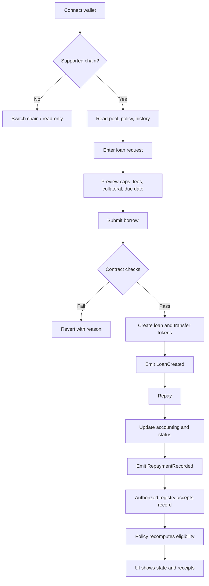
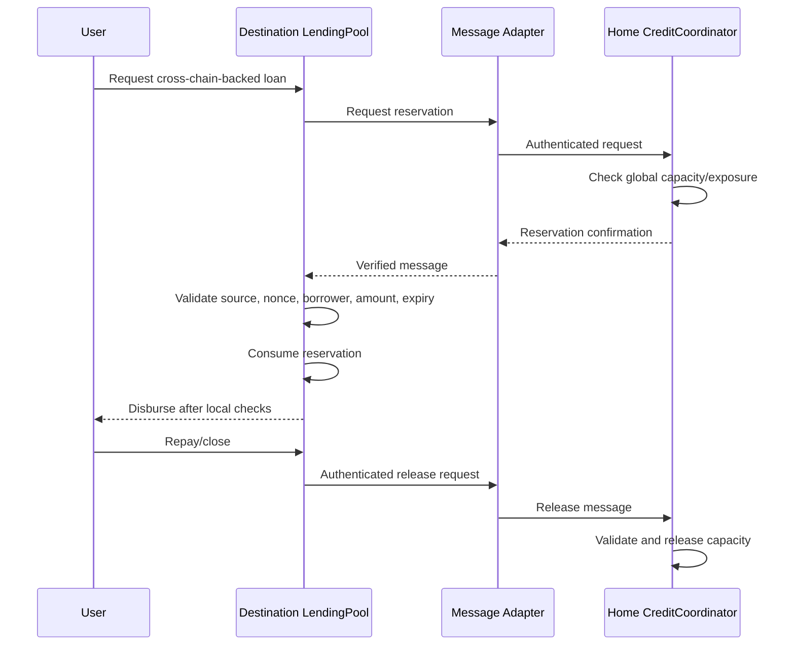
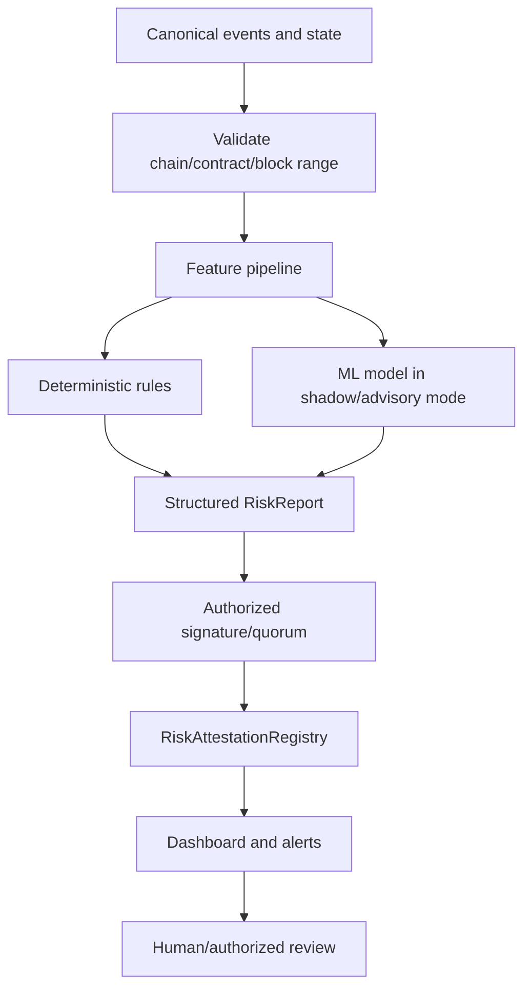

# AUREX End-to-End Workflows

**Version:** 4.0.0

## 1. Single-chain lending

## 2. Cross-chain credit reservation

Delayed confirmation means no disbursement; delayed release means capacity remains encumbered. Cross-chain steps are asynchronous, not atomic.

## 3. AI monitoring

The AI path never calls lending functions or mutates policy.

## 4. Repayment-history update
1. Lending contract verifies funds received.
2. Loan state updates and event is emitted.
3. Registry accepts record only from authorized contract/attestor.
4. Unique record ID binds chain, contract, loan, sequence, and outcome.
5. Duplicate record is rejected.
6. Credit policy reads accepted history and current exposure.
7. Eligibility changes only under the published policy.

## 5. Future order book
Submit order → validate funds/reservation and market state → match under published deterministic rules → settle atomically on the local chain → release unused reservations exactly once. If a centralized matcher is used, disclose it; do not claim fully onchain matching.

## 6. Future perpetual engine
Deposit margin/eligible credit → validate margin, oracle, and exposure → open/update position → calculate funding by documented formula → evaluate margin → liquidate only under deterministic contract rules → emit position/funding events.

## 7. Future market maker
Strategy proposes quote → contract validates price/inventory/capital bounds → quote or trade executes under chosen market design → inventory/exposure updates → monitoring alerts on deviations. Strategy cannot bypass limits.

## 8. Hackathon demo sequence
Show testnet loan; show repayment and eligibility change; attempt over-limit borrow; demonstrate mocked reservation and replay rejection; trigger AI scenario and register evidence-linked report; prove AI signer cannot mutate policy or move funds; show test report. Label any mock route or simulated market clearly.
